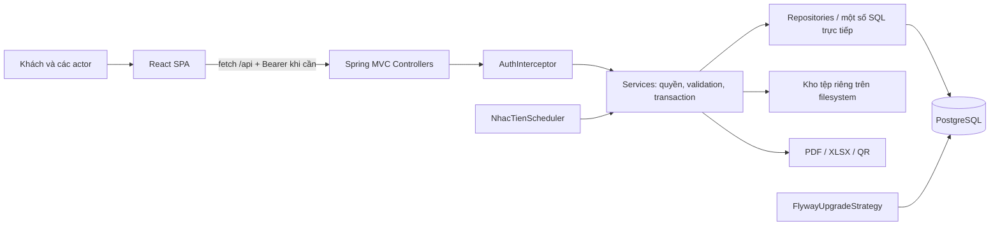
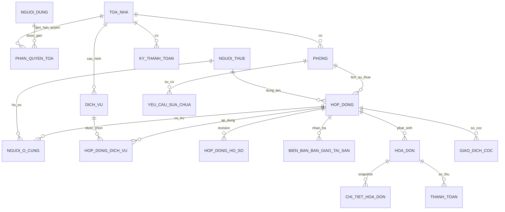

# MiniApart — System Context cho AI tiếp quản

## 0. Phạm vi, phiên bản và độ tin cậy

- **Repository được phân tích:** `MiniApart-main`, nhánh `main`.
- **HEAD:** `38b388d794a63bb2e3f7e4d23b7c3e6e9cd0ac0e` — `feat(demo): add isolated realistic presentation dataset with transactional verification`.
- **Mốc ghi trạng thái:** 06/11/2026, 11:34:59, UTC+07:00. Đây là working tree thực tế, **không phải chỉ nội dung commit HEAD**.
- Tại mốc trên: **117 mục Git thay đổi**, gồm **113 mục có thay đổi staged**, **16 mục có thay đổi unstaged**, **3 file untracked**. Các nhóm có thể chồng nhau: `AM`/`MM` có cả staged và unstaged.
- Untracked quan trọng: `backend/src/main/java/com/prj1/ccm/dashboard/DiemDoDungChungService.java`, `backend/src/main/resources/db/migration/V62__utility_alert_unique_and_audit.sql`, `backend/src/test/java/com/prj1/ccm/dashboard/DiemDoDungChungServiceTest.java`.
- Dashboard chủ/quản lý, UI, dữ liệu trình diễn, ảnh và một số test còn chưa commit. Repo có thể tiếp tục thay đổi trong lúc phân tích; chạy lại `git status` và diff trước khi triển khai.
- Worktree `MiniApart-worker-dashboard`, nhánh `anti/worker-dashboard`, tại mốc kiểm tra vẫn ở `553e974`, có tài liệu giao việc V2 chưa commit. **Dashboard thợ mở rộng, báo giá, trả tiền thợ và batch demo mới là yêu cầu triển khai, chưa phải chức năng đã có trong main.** Worktree `MiniApart-demo-data` là nhánh dữ liệu riêng; không tự coi hai worktree đã tích hợp.

**Quy ước bằng chứng:**

- **CODE:** đã đọc implementation/caller trực tiếp; mô tả hành vi code, không đồng nghĩa đã chạy thành công.
- **DDL:** có trong migration; không khẳng định database đang chạy đã áp dụng migration đó.
- **TEST:** tồn tại test tương ứng; không đồng nghĩa test PASS.
- **CHƯA KIỂM CHỨNG:** cần kiểm thử runtime, SQL trên database riêng hoặc browser.

Lượt lập tài liệu này **không chạy build/test, migration, seeder, truy vấn database hoặc thao tác nghiệp vụ**, không sửa source. Không dùng kết quả kiểm thử từ phiên trước làm nghiệm thu phiên bản đang sửa dở. Không đưa giá trị secret, thông tin đăng nhập, định danh cá nhân hoặc tài khoản nhận tiền vào tài liệu.

Để rút gọn đường dẫn trong các bảng: **B** = `backend/src/main/java/com/prj1/ccm/`; **F** = `frontend/src/`; **M** = `backend/src/main/resources/db/migration/`; **T** = `backend/src/test/java/com/prj1/ccm/`. Ví dụ `B/hopdong/HopDongService.java` là đường dẫn đầy đủ sau khi thay tiền tố B. Tên class trong cùng một ô module thuộc package đã ghi trong ô đó.

## 1. Kiến trúc tổng thể

MiniApart quản lý tòa nhà/phòng cho thuê, hợp đồng, cư trú, dịch vụ định kỳ, hóa đơn, thu tiền/cọc, sửa chữa và vận hành. Kiến trúc quan sát được là **một backend triển khai chung, chia package theo nghiệp vụ**, một React SPA và PostgreSQL; không phải các microservice riêng cho từng module.



Sơ đồ thể hiện thành phần logic; interceptor thực thi trước controller được bảo vệ. Luồng chuẩn là Controller → Service → Repository → JDBC. **Không đồng nhất mọi module với chuẩn này:** `PcccService` dùng `JdbcTemplate` trực tiếp; `CuTruController`, `NhatKyThaoTacController`, `ThayTheHoaDonController` cũng chứa SQL/điều phối. Đọc implementation thật trước khi thêm lớp hoặc refactor.

| Thành phần | Công nghệ đã thấy | Bằng chứng |
| --- | --- | --- |
| Backend | Java toolchain 24, Spring Boot 4.1.1, Spring MVC, JDBC, transaction; DTO/record và SQL tường minh | `backend/build.gradle`, `B/MiniApartApplication.java` |
| JSON | Jackson qua namespace `tools.jackson` của stack đang dùng | `B/auth/JwtTokenService.java`, `B/hopdong/HopDongController.java` |
| Database | PostgreSQL; Compose dùng image major 17; Flyway | `docker-compose.yml`, `backend/build.gradle`, `B/config/FlywayUpgradeStrategy.java` |
| Frontend | React 19.2.0, TypeScript 5.9.3, Vite 8.2.0; chỉ React/React DOM là dependency runtime được khai báo | `frontend/package.json` |
| PDF/QR/XLSX | OpenPDF 2.0.3 + font extra; ZXing 3.5.3; XLSX do class riêng tạo | `backend/build.gradle`, `B/hopdong/HopDongPdfService.java`, `B/billing/VietQrPayloadBuilder.java`, `B/report/XlsxBaoCao.java` |
| Test | JUnit/Spring Boot Test, Testcontainers, ArchUnit, jqwik; Vitest + jsdom | `backend/build.gradle`, `frontend/package.json` |
| Đóng gói | Gradle bootJar; frontend build tĩnh → Nginx; Compose; Caddy cho HTTPS production | `backend/Dockerfile`, `frontend/Dockerfile`, `frontend/nginx.conf`, `docker-compose.production.yml`, `deploy/Caddyfile` |

Không áp mẫu JPA/Hibernate entity/repository vào đây: dependencies và repository đã đọc dùng JDBC. Không giả định có Redux, React Router, TanStack Query, thư viện chart hoặc Spring Security: chúng không được khai báo trong các manifest hiện tại. UI có chart/component dựng bằng code dự án.

### Cấu trúc thư mục

```text
backend/
  src/main/java/com/prj1/ccm/  các package nghiệp vụ
  src/main/resources/
    application.yml          cấu hình bằng biến môi trường
    db/migration/            migration canonical
    db/migration_variants/   artifact lịch sử cho compatibility
    static/rooms/            ảnh phòng công khai
  src/test/java/             unit, integration, property, architecture tests
frontend/
  src/App.tsx                session, route/role dispatch, shell
  src/api.ts                 DTO và API phần lớn nghiệp vụ
  src/managementApi.ts        helper request quản trị
  src/financeApi.ts           helper hóa đơn/thanh toán/cọc/tải file
  src/design/                component dùng chung
  src/tokens/                design tokens
  public/                    ảnh công khai, asset demo
deploy/                      proxy, quyền DB, backup/restore scripts
scripts/                     khởi chạy, tạo demo, bổ sung fixture
docs/                        tài liệu dự án/review/bàn giao
.scratch/, Doc/              tài liệu lịch sử; không ưu tiên hơn code
```

## 2. Bản đồ toàn bộ module backend và frontend

Các chức năng bên dưới **đã có đường code**, trừ nơi ghi đang triển khai. Không hiểu cột này là toàn bộ đã nghiệm thu.

| Package backend | Trách nhiệm và lớp đầu mối | Màn/component frontend tương ứng |
| --- | --- | --- |
| `auth` | Login, JWT, khóa đăng nhập, kích hoạt, reset mật khẩu; `AuthController`, `XacThucService`, `JwtTokenService`, `KichHoatTaiKhoanService`, `DatLaiMatKhauService`, `NguoiDungRepository` | `App.tsx`, `TaiKhoanTruyCap.tsx`, `authSession.ts` |
| `nguoidung` | Quản trị tài khoản, vai trò, khóa và gán tòa; `QuanLyNguoiDungController/Service`, `NguoiDung`, `VaiTro`; repository tài khoản nằm trong `auth` | `QuanLyTaiKhoan.tsx` |
| `toanha` | Tòa/phòng/dịch vụ/bảng giá, giá riêng phòng, trạng thái phòng, kỳ và công tơ, nhân khẩu kỳ, Bên A và mẫu hợp đồng; `ToaNhaController`, các `DanhMuc*Service`, `BangGiaDichVuService`, `KyThanhToanService`, `ChiSoDichVuService`, `PhanQuyenToaService` | `DanhMucToaNha.tsx`, `DanhMucPhong.tsx`, `DichVuVaKy.tsx`, `GhiChiSo.tsx`, một phần `HopDongThaoTac.tsx` |
| `publicportal` | Danh mục công khai, phòng, giá/tiện ích, lịch hẹn xem phòng; `PublicPortalController/Service/Repository`, `LichHenQuanLyController` | `KhamPhaPhong.tsx`, `QuanLyLichHen.tsx`, `roomAmenities.ts` |
| `nguoithue` | Hồ sơ cá nhân, ảnh giấy tờ/đính kèm, khai báo cư trú, audit; `NguoiThueController/Service/Repository`, `AnhDinhKem*`, `CuTruController`, `NhatKyThaoTac*` | `HoSoNguoiThue.tsx`, `CuTruVanHanh` và `NhatKyVanHanh` trong `TuanThuVanHanh.tsx` |
| `hopdong` | Tạo/cọc/kích hoạt/gia hạn/thanh lý; người ở cùng; hồ sơ revision, mẫu/snapshot/phụ lục/PDF; `HopDongController/Service/Repository`, `NguoiOCung*`, `HopDongHoSoRepository`, `HopDongPhuLucRepository`, `HopDongPdfService` | `HopDongQuanLy.tsx`, `HopDongThaoTac.tsx`, `HopDongNguoiThue.tsx`, phần người ở cùng/tài sản |
| `taisan` | Tài sản phòng; biên bản nhận/trả và snapshot chi tiết, tổng khấu trừ; `TaiSanController/Service/Repository` | `QuanLyTaiSanPhong.tsx`, được liên kết từ thao tác hợp đồng |
| `billing` | Nháp/phát hành/sửa/hủy/thay thế hóa đơn, khoản phát sinh, sổ thu/đối ứng, số dư, cọc/quyết toán, QR/PDF; các service chuyên trách thay vì một BillingService | `HoaDonQuanLy.tsx`, `HoaDon.tsx`, `ThuTien.tsx`, `InvoiceActions.tsx`, `FinancePaymentPanel.tsx`, `financeApi.ts` |
| `billing.calc` | Lõi tính tiền thuần Java, chiến lược theo chỉ số/cố định/người/số lượng, giá cố định/bậc thang, làm tròn, trạng thái hóa đơn, thanh lý | Không gọi trực tiếp từ browser; dùng qua billing API |
| `portal` | API đăng nhập của người thuê: hóa đơn riêng, lịch sử, tiêu thụ, hợp đồng; `CongNguoiThueController` gọi service `billing`/`hopdong` | `HoaDon.tsx`, `LichSuHoaDon.tsx`, `BieuDoTieuThu.tsx`, `HopDongNguoiThue.tsx` |
| `suachua` | Báo hỏng, tiếp nhận, giao thợ, xử lý, chờ xác nhận/đóng/hủy, chi phí/lịch sử; `YeuCauSuaChua*`, `ThoSuaChuaController`, `CongSuaChuaController`, `QuyTacTrangThaiYeuCau` | `QuanLySuaChua.tsx`, `LichSuSuaChua.tsx`, `ViecCuaToi.tsx` |
| `thongbao` | Inbox/đã đọc/lưu trữ, broadcast theo phạm vi, nhắc tiền có milestone, bảng việc vận hành; `ThongBao*`, `NhacTien*`, `BangViecVanHanh*` | `ThongBao.tsx`, `BangViecVanHanh.tsx`, badge trong shell |
| `antoan` | Hồ sơ/tệp PCCC, thiết bị, kiểm tra và lịch kiểm tra; `PcccController`, `PcccService` | `AnToanVanHanh` trong `TuanThuVanHanh.tsx` |
| `report` | Tổng quan, công nợ, tiêu thụ điện/nước, chi phí bảo trì và XLSX; `TongQuanBaoCao*`, `CongNoBaoCao*`, `TieuThuBaoCao*`, `ChiPhiBaoTriBaoCao*`, `BaoCaoExcelController` | `BaoCaoTongQuan.tsx`, `CongNoBaoCao.tsx`, `TieuThuBaoCao.tsx`, `ChiPhiBaoTriBaoCao.tsx`, `ExcelExportButton.tsx` |
| `dashboard` | **Đang sửa, chưa commit:** tổng quan CHU/QUAN_LY, điểm đo chung, đối soát/cảnh báo; `DashboardChu*`, `DashboardQuanLy*`, `DiemDoDungChung*`, `DoiSoatDienNuocService`, `CanhBaoTieuThu*` | `ChuDashboard.tsx`, `QuanLyDashboard.tsx`; một phần API đang sửa trong `api.ts` |
| `config`, `health`, application | Compatibility migration, guard production, health có kiểm tra DB, entrypoint | Không phải công việc người dùng; health dùng chẩn đoán/kết nối |

Nguồn map màn → module: `F/App.tsx` (imports và nhánh render), `F/roleNavigation.ts`; map backend: class/controller thực tế trong các package trên. Một số màn như `HoSoNguoiThue`/`HopDongThaoTac` là tập hợp nhiều nghiệp vụ, không tương ứng một bảng duy nhất.

## 3. Actor, xác thực và phạm vi dữ liệu

### 3.1 Cách xác thực

`AuthWebConfig` đăng ký `AuthInterceptor` cho `/api/**`. Interceptor kiểm tra Bearer JWT, chữ ký/hạn dùng, đọc lại người dùng từ DB, yêu cầu tài khoản hoạt động, không đang khóa và `phien_ban_token` khớp. Đối tượng đặt ở `AuthInterceptor.CURRENT_USER_ATTRIBUTE`; service phải dùng đối tượng này, không tin userId client.

`JwtTokenService` dùng HS256, claim chính `sub`, `ver`, `iat`, `exp`; TTL cấu hình qua `app.auth.token-ttl-seconds`. `PasswordHasher` dùng PBKDF2-HMAC-SHA256 với salt ngẫu nhiên. `XacThucService`/`TheoDoiDangNhap` theo dõi đăng nhập sai; khóa và đổi phiên bản token cần được giữ khi sửa tài khoản. Login hiện dùng **số điện thoại**, không dùng CCCD làm username.

Ngoại lệ xác thực được khai báo cụ thể: health, login/kích hoạt/quên/reset mật khẩu, `/api/public/**`, endpoint xem QR đã ký. Ảnh `/api/anh/{id}/xem` còn có đường truy cập bằng capability URL có chữ ký; service xác minh chữ ký/hạn và thêm quyền theo loại ảnh. **Không biến mọi endpoint ảnh thành public chỉ vì interceptor có ngoại lệ.**

Nguồn: `B/auth/AuthWebConfig.java`, `AuthInterceptor.java`, `JwtTokenService.java`, `PasswordHasher.java`, `XacThucService.java`; `B/nguoithue/AnhDinhKemService.java`.

### 3.2 Ma trận actor

| Actor | Phạm vi thực tế/đầu mối kiểm tra | Giao diện chính |
| --- | --- | --- |
| Khách chưa đăng nhập | Chỉ DTO công khai và tạo lịch xem; không có dữ liệu hợp đồng/cư dân nội bộ | Danh mục phòng/trang khám phá |
| `QTHT` | Quản trị tài khoản/quyền, danh sách tòa ở luồng được cho phép, audit; **không phải superuser nghiệp vụ mặc định** | Tài khoản, tòa nhà, nhật ký |
| `CHU` | Nghiệp vụ trên tòa có `PHAN_QUYEN_TOA`; tạo tòa tự cấp quyền cho người tạo; báo cáo tài chính; một số thao tác chủ độc quyền như hủy hóa đơn phát hành/thay thế, ghi PCCC | Tổng quan, danh mục, hợp đồng, hóa đơn/tiền, vận hành, báo cáo |
| `QUAN_LY` | Tòa được gán; quản lý phòng/hợp đồng/cư trú/sự cố, ghi chỉ số, hóa đơn/thu tiền; không được mặc định quyền báo cáo CHU hoặc sửa PCCC | Nhắc việc/dashboard quản lý và các màn vận hành |
| `THO` | Yêu cầu có `nguoi_xu_ly_id` bằng người dùng hiện tại; **không gán quyền toàn tòa cho thợ** | Hiện main có Việc của tôi và Thông báo |
| `NGUOI_THUE` | `NGUOI_DUNG.nguoi_thue_id` gắn hồ sơ; hợp đồng/hóa đơn cổng thuê chủ yếu theo người đứng tên; sửa chữa theo người tạo; người ở cùng không tự thừa hưởng quyền tài chính của người đứng tên | Hóa đơn của tôi, lịch sử, tiêu thụ, hợp đồng, báo hỏng |

Nguồn: `B/toanha/PhanQuyenToaService.java`, `ToaNhaRepository.java`, `DanhMucToaNhaService.java`; `B/nguoidung/QuanLyNguoiDungService.java`; `B/hopdong/HopDongService.java#chiTietCuaNguoiThue`; `B/suachua/YeuCauSuaChuaService.java#kiemTraQuyenXem`; `F/roleNavigation.ts`.

Frontend menu/route guard **không phải ranh giới bảo mật**. Phải kiểm tra role + building scope + quan hệ tài nguyên ngay tại backend. Ví dụ `PhanQuyenToaService.layToaNhaNeuNhanVienDuocXem` chỉ cho CHU/QUAN_LY và yêu cầu quan hệ quyền. Đừng suy ra CHU thấy mọi tòa hoặc QTHT được đọc mọi dữ liệu thuê.

**Phân biệt chủ thể:** `NGUOI_DUNG` là tài khoản; `NGUOI_THUE` là hồ sơ cá nhân; `HOP_DONG.nguoi_thue_id` là người đứng tên; `NGUOI_O_CUNG` là cư trú theo thời gian/trạng thái duyệt; `CAU_HINH_BEN_A_TOA_NHA` là chủ thể/người ký Bên A. Có quyền quản lý tòa không chứng minh là chủ sở hữu hoặc được ủy quyền ký. Hai nhóm trạng thái thuê và ký được trình bày ở mục 6.

## 4. Mô hình database và migration

### 4.1 Sơ đồ quan hệ cốt lõi



Đây là sơ đồ chọn lọc. Không có cạnh không đồng nghĩa không có FK; danh mục dưới bao phủ các bảng được khai báo trong canonical migrations.

### 4.2 Danh mục schema theo nghiệp vụ

Tại mốc kiểm tra có **48 bảng được khai báo CREATE TABLE** trong **52 file migration**. Đây là inventory DDL, không phải truy vấn `information_schema` trên database thật.

| Nhóm bảng | Vai trò/quan hệ chính | Migration nguồn |
| --- | --- | --- |
| `NGUOI_DUNG`, `PHAN_QUYEN_TOA` | Tài khoản và quan hệ nhiều-nhiều tài khoản–tòa; account liên kết tùy chọn hồ sơ thuê | V2, V11 |
| `LAN_DANG_NHAP_SAI`, `THEO_DOI_DANG_NHAP`, `KICH_HOAT_TAI_KHOAN`, `DAT_LAI_MAT_KHAU` | Theo dõi khóa, kích hoạt và reset; không công khai token/hash trong DTO | V3–V6, V50 |
| `TOA_NHA`, `PHONG` | Tòa có phòng; giá thuê mặc định, diện tích/sức chứa, trạng thái đệm/marker dừng khai thác; ảnh/mô tả công khai bổ sung sau | V2, V7, V17, V28, V39, V49, V51 |
| `DICH_VU`, `BANG_GIA`, `BANG_GIA_BAC_THANG`, `BANG_GIA_PHONG` | Dịch vụ theo tòa; giá theo ngày hiệu lực; giá phòng override; bậc thang là các dòng cùng phiên ngày | V7–V8, V60 |
| `NGUOI_THUE`, `NHAT_KY_THAO_TAC` | Hồ sơ, thông tin giấy tờ/liên hệ/cư trú; audit có phạm vi tòa | V9, V52–V53, V58 |
| `ANH_DINH_KEM` | Metadata ảnh với loại/ID đối tượng; khóa lưu trữ riêng, không chứa ảnh binary trong bảng | V10, V17, V36, V46 |
| `HOP_DONG`, `HOP_DONG_DICH_VU` | Hợp đồng theo phòng/người đứng tên; dịch vụ và đơn giá áp dụng của hợp đồng | V12–V13 |
| `NGUOI_O_CUNG` | FK hợp đồng và hồ sơ người; khoảng cư trú, vai trò, trạng thái duyệt, người đề nghị/duyệt | V14, V60 |
| `CAU_HINH_BEN_A_TOA_NHA`, `MAU_HOP_DONG` | Chủ thể/người ký Bên A theo tòa; mẫu có phiên bản/trạng thái/nội dung | V58 |
| `HOP_DONG_HO_SO`, `HOP_DONG_PHU_LUC` | Revision hồ sơ, Bên A/B/phòng/điều khoản và JSON snapshot; phụ lục theo số/ngày hiệu lực | V58–V60 |
| `KY_THANH_TOAN`, `CHI_SO_DICH_VU`, `XAC_NHAN_CANH_BAO_CHI_SO`, `NHAN_KHAU_KY` | Kỳ theo tòa; chỉ số kỳ–phòng–dịch vụ; xác nhận bất thường; snapshot số người khi chốt | V15–V21 |
| `HOA_DON`, `CHI_TIET_HOA_DON`, `CHI_TIET_HOA_DON_BAC_THANG` | Header, các dòng tiền và chi tiết bậc giá đã tính; hóa đơn có thể tham chiếu hóa đơn bị thay thế | V22, V24–V25, V30, V54 |
| `KHOAN_PHAT_SINH`, `SO_DU_KHA_DUNG` | Phát sinh/giảm trừ có nguồn nghiệp vụ; tiền thừa gắn hợp đồng, hóa đơn nguồn và hóa đơn sử dụng | V23, V27, V38 |
| `THANH_TOAN`, `GIAO_DICH_COC` | Sổ thu/đối ứng/quyết toán theo hóa đơn tách khỏi sổ thu/hoàn/khấu trừ cọc theo hợp đồng | V26, V29, V31 |
| `YEU_CAU_SUA_CHUA` | Phòng/hợp đồng/người tạo/người xử lý, trạng thái/mốc thời gian, chi phí và bên chịu phí | V36, V38 |
| `THONG_BAO`, `THONG_BAO_CHUNG` | Bản nhận theo tài khoản và broadcast có nội dung/phạm vi/khóa chống lặp | V37, V46 |
| `NHAC_TIEN_MOC`, `NHAT_KY_NHAC_TIEN` | Milestone gửi và lịch sử xử lý nhắc nợ | V47–V48 |
| `LICH_HEN_XEM_PHONG` | Lead/lịch xem theo tòa và phòng tùy chọn, trạng thái hẹn | V49 |
| `PCCC_HO_SO`, `PCCC_THIET_BI`, `PCCC_KIEM_TRA` | Hồ sơ có tệp, thiết bị/hạn kiểm định, biên bản kiểm tra của tòa | V51 |
| `TAI_SAN_PHONG`, `BIEN_BAN_BAN_GIAO_TAI_SAN`, `CHI_TIET_BIEN_BAN_TAI_SAN` | Tài sản sống theo phòng; biên bản theo hợp đồng/phòng; tên/số lượng/tình trạng/khấu trừ snapshot | V55–V57 |
| `DIEM_DO_DUNG_CHUNG`, `CHI_SO_DUNG_CHUNG`, `CANH_BAO_TIEU_THU` | Điểm đo điện/nước chung/tổng, chỉ số theo kỳ, cảnh báo; module chưa nghiệm thu | V61; V62 thêm unique index, đang untracked |

Không thấy bảng báo giá có phiên bản hoặc ledger trả tiền thợ trong inventory main này. Không tự đổi tên `THANH_TOAN` thành ledger trả thợ: hiện nó FK tới hóa đơn thuê.

### 4.3 Constraint và bất biến được database bảo vệ

| Bất biến DDL | Chi tiết cần giữ | Bằng chứng |
| --- | --- | --- |
| Account gắn hồ sơ | Số điện thoại tài khoản unique; `nguoi_thue_id` là FK nullable và unique, một hồ sơ không gắn nhiều account | V2, `M/V11__link_account_to_tenant.sql` |
| Phòng duy nhất trong tòa | `UNIQUE(toa_nha_id, so_phong)`, không unique số phòng toàn hệ thống | `M/V7__building_catalog.sql` |
| Không chồng hợp đồng | Exclusion GiST trên phòng và `daterange(ngay_bat_dau, ngay_ket_thuc, '[]')`, trừ DA_THANH_LY; **hai đầu inclusive**, cần giữ cách tính ngày gia hạn | `M/V13__exclude_overlapping_rental_contracts.sql` |
| Kỳ duy nhất | Unique tòa–năm–tháng; partial unique một DANG_MO/tòa | `M/V15__payment_periods.sql` |
| Chỉ số/nhân khẩu kỳ | Unique kỳ–phòng–dịch vụ; unique kỳ–phòng cho nhân khẩu; thay công tơ có trường và validation riêng | V16, V19, V21 |
| Hóa đơn thay thế | Partial unique hợp đồng–kỳ cho bản chưa hủy; unique tham chiếu hóa đơn gốc bị thay; `ky_id` cho phép NULL để quyết toán | V30, V54 |
| Hồ sơ/mẫu/phụ lục | Unique hợp đồng–revision, tòa–phiên bản mẫu, hợp đồng–số phụ lục | V58 |
| Số tiền và số dư | Tiền phần lớn NUMERIC(15,2); số dư khả dụng dương, cặp hóa đơn sử dụng/ngày sử dụng đồng bộ; không dùng floating point để thay tiền | V7, V12, V22–V29; `T/architecture/MoneySchemaRegressionTest.java` |
| Audit append-only | Trigger chặn UPDATE/DELETE/TRUNCATE, gán phạm vi tòa; cần quyền DB phù hợp, không coi trigger bảo vệ được khỏi mọi superuser | `M/V53__audit_append_only.sql`, `deploy/init-app-user.sh` |
| Idempotency broadcast/nhắc nợ | Unique người gửi–khóa chống lặp; unique hóa đơn–người nhận–mốc nhắc | V46–V47 |

FK độc lập chỉ chứng minh ID tồn tại, **không luôn chứng minh cùng tòa/phòng/hợp đồng**. Các liên kết kỳ–tòa, phòng–dịch vụ, tài sản–phòng và biên bản–hợp đồng còn cần service validation. Không bỏ service guard với lý do đã có FK.

### 4.4 Migration và dữ liệu lịch sử

- Canonical nằm tại `M/`; có khoảng trống phiên bản (V32–V35, V40–V45 không có file trong inventory). Không tự tạo file bù hoặc đánh lại số lịch sử.
- `B/config/FlywayUpgradeStrategy.java` đọc cấu hình schema/history table, chọn artifact lịch sử tương thích cho migration đã áp dụng (V49/V55 và compatibility V58 draft), vẫn validate. Migration pending dùng canonical; checksum lạ fail-fast. `backend/src/main/resources/db/migration_variants/` là artifact lịch sử, không phải thư mục seed để chạy lại.
- V49/V55 canonical đã tách demo của các đợt trước; **không suy ra toàn bộ migration tree không chứa dữ liệu mẫu**: V2 vẫn có INSERT khởi tạo. Đọc đúng file trước khi chạy database mới.
- V56/V57 xử lý khác biệt tên cột khấu trừ legacy; V59/V60 xử lý cột hồ sơ và mở rộng cư trú/giá. Không sửa checksum/repair history để bỏ qua lỗi; không xóa dữ liệu theo tên trông giống demo.
- V61/V62 là schema mới đang làm; số migration cao nhất trong source không chứng minh đã áp dụng ở database nào. Không khởi động bootRun vào datasource thật để kiểm thử migration.

Nguồn kiểm chứng hiện diện: `T/architecture/MigrationUpgradeHistoryIntegrationTest.java`, `DemoDataSeederIntegrationTest.java`; **chưa chạy trong lượt này**.

## 5. API chính và đường đi thực thi

API dùng DTO JSON, một số command multipart; role được lấy từ request attribute. Đường dẫn và HTTP method dưới đây lấy từ controller, không từ tên màn. `ResponseStatusException` được dùng phổ biến cho 400/403/404/409; auth có `AuthExceptionHandler`/`AuthErrorWriter` riêng. Frontend phải xử lý theo response thực tế, không giả định mọi module có cùng error envelope.

| Nhóm API thực tế | HTTP/đường dẫn tiêu biểu | Controller → xử lý/persistence |
| --- | --- | --- |
| Auth | POST `/api/auth/login`, `/kich-hoat`, `/quen-mat-khau`, `/dat-lai-mat-khau`; GET `/api/auth/me` | `B/auth/AuthController.java`, `DatLaiMatKhauController` → service auth → `NguoiDungRepository`/reset repository |
| Tài khoản | GET/POST `/api/nguoi-dung`; PUT `/{id}`; POST `/{id}/khoa`; GET `/vai-tro` | `B/nguoidung/QuanLyNguoiDungController.java` → `QuanLyNguoiDungService` → repository trong `auth` |
| Public | GET `/api/public/toa-nha`, `/phong`, `/phong/{id}`; POST `/dat-lich-hen` | `B/publicportal/PublicPortalController.java` → `PublicPortalService` → `PublicPortalRepository`; đồng bộ trạng thái phòng khi đọc |
| Lịch hẹn nội bộ | GET `/api/lich-hen`; PATCH `/{id}/trang-thai` | `B/publicportal/LichHenQuanLyController.java` → service/repository publicportal có scope người dùng |
| Tòa/phòng/dịch vụ | `/api/toa-nha`, `/{toaNhaId}/phong`, `/phong/hang-loat[/xem-truoc]`, `/{toaNhaId}/dich-vu`; PUT marker ngừng cho thuê | `B/toanha/ToaNhaController.java` → `DanhMucToaNhaService`, `DanhMucPhongService`, `DanhMucDichVuService` → repository tương ứng |
| Bảng giá | GET/POST `/api/dich-vu/{id}/bang-gia`, `/{id}/bac-thang`; GET `/api/phong/{id}/bang-gia-dich-vu`; POST `/api/phong/{id}/dich-vu/{dvId}/bang-gia` | `B/toanha/BangGiaController.java`, `BangGiaPhongController.java` → `BangGiaDichVuService` → `BangGiaRepository`, `BangGiaPhongRepository` |
| Kỳ/chỉ số | `/api/toa-nha/{toaNhaId}/ky-thanh-toan`; POST `/{kyId}/chot`; GET `/{kyId}/thieu-chi-so`, `/{kyId}/chi-so`; ghi/sửa chỉ số theo mapping trong controller | `ToaNhaController` → `KyThanhToanService`/`ChiSoDichVuService` → kỳ/chỉ số/nhân khẩu repositories |
| Hợp đồng | GET/POST `/api/hop-dong`; GET `/{id}`; POST `/{id}/nhan-coc`, `/kich-hoat`, `/gia-han`, `/thanh-ly` | `B/hopdong/HopDongController.java` → `HopDongService` → hợp đồng + billing/cọc/trạng thái phòng |
| Hồ sơ/điều khoản | GET `/{id}/ho-so`; PUT `/ho-so/draft`; POST `/ho-so/chot`, `/ghi-nhan-ky`, `/mo-lai-draft`; GET/POST `/{id}/phu-luc` | `HopDongController` → `HopDongService` → `HopDongHoSoRepository`, `HopDongPhuLucRepository` |
| Bên A/mẫu | GET/PUT `/api/toa-nha/{id}/ben-a`; GET/POST `/api/toa-nha/{id}/mau-hop-dong`, GET `/published`, `/chuan` | `B/toanha/CauHinhBenAController.java`, `MauHopDongController.java` → repository với guard tòa |
| Người ở cùng | `/api/hop-dong/{id}/nguoi-o-cung`; PUT `/{nocId}/duyet`, `/tu-choi`, `/roi-phong`; POST `/{nocId}/kich-hoat-tai-khoan` | `B/hopdong/NguoiOCungController.java` → `NguoiOCungService` → cư trú/hồ sơ/account repositories |
| Tài sản/bàn giao | GET/POST `/api/phong/{id}/tai-san`; DELETE `/api/tai-san/{id}`; GET/POST `/api/hop-dong/{id}/bien-ban-tai-san` | `B/taisan/TaiSanController.java` → `TaiSanService` → `TaiSanRepository` |
| Hóa đơn theo kỳ | Base `/api/toa-nha/{toaNhaId}/ky-thanh-toan/{kyId}/hoa-don`: GET `/tinh-thu`; POST `/tao-hang-loat`, `/phat-hanh-hang-loat`, `/{id}/phat-hanh`, `/noi-dung`, `/huy`, `/thanh-toan`; GET `/{id}` | `B/billing/HoaDonController.java` → service chuyên trách → `TinhHoaDonRepository`, `HoaDonChiTietRepository`, `ThanhToanRepository` |
| Danh sách/thay thế | GET `/api/hoa-don`; POST base kỳ ở trên + `/{id}/thay-the` | `HoaDonDanhSachController` → `HoaDonDanhSachService`; `ThayTheHoaDonController` điều phối transaction hủy + tạo thay thế |
| Sổ tiền/đối ứng | GET `/api/hoa-don/{id}/thanh-toan`; POST `/api/thanh-toan/{id}/doi-ung`; GET `/{id}/bien-lai-pdf` | `LichSuThanhToanController`, `ThanhToanController` → `ThanhToanService`/repository/PDF |
| Cọc/phát sinh/quyết toán | GET/POST `/api/hop-dong/{id}/giao-dich-coc`; POST `/{id}/khoan-phat-sinh`; POST `/{id}/hoa-don-quyet-toan/{hdId}/thanh-toan` | `GiaoDichCocController`, `KhoanPhatSinhController`, `HopDongController` → service billing |
| Portal người thuê | GET `/api/cong/hoa-don-moi-nhat`, `/hoa-don`, `/hoa-don/{id}`, `/tieu-thu`, `/hop-dong`, `/hop-dong/{id}` | `B/portal/CongNguoiThueController.java` → service billing/hợp đồng xác định scope từ tài khoản |
| Sửa chữa | Base `/api/yeu-cau-sua-chua`: GET list/detail/history; POST tạo, `/{id}/tiep-nhan`, `/phan-cong`, `/bat-dau-xu-ly`, `/hoan-thanh`, `/xac-nhan-dong`, `/huy`; PUT `/{id}/chi-phi` | `B/suachua/YeuCauSuaChuaController.java` → `YeuCauSuaChuaService` → repository + trạng thái phòng + thông báo + khoản phát sinh |
| Thợ/thuê báo hỏng | GET `/api/tho/viec-cua-toi`; GET `/api/cong/yeu-cau-sua-chua` | `ThoSuaChuaController`, `CongSuaChuaController` → cùng service sửa chữa, scope riêng |
| Thông báo/bảng việc | `/api/thong-bao`, `/luu-tru`, `/{ref}/da-doc`, POST `/chung/xem-truoc`, `/chung`; GET `/api/toa-nha/{id}/bang-viec` | `B/thongbao/ThongBaoController.java`, `BangViecVanHanhController.java` → services/repositories |
| Báo cáo | GET `/api/bao-cao/tong-quan`, `/cong-no`, `/tieu-thu`, `/chi-phi-bao-tri`; mỗi nhóm có `/xuat-excel` | Các controller trong `B/report/` → service scoped → repository; export dùng cùng DTO/filter |
| Tuân thủ | `/api/toa-nha/{id}/pccc`; `/api/toa-nha/{id}/cu-tru`; `/api/nhat-ky-thao-tac` | `PcccController/Service`, `CuTruController`, `NhatKyThaoTacController` |
| Dashboard mới | GET `/api/dashboard/chu`, `/quan-ly`; `/api/cong-to-dung-chung` + `/chi-so`, `/ghi-chi-so`, `/doi-soat`; `/api/canh-bao-tieu-thu` | Controller/service/repository trong `B/dashboard/`; còn đang sửa |
| File/PDF/QR | GET `/api/anh/{id}/lien-ket`, `/{id}/xem`; `/api/hop-dong/{id}/xuat-pdf`; base hóa đơn + `/{id}/xuat-pdf`, `/ma-qr-chuyen-khoan[/xem]` | `AnhDinhKem*`, `HopDongPdf*`, `HoaDonController`, `MaQrChuyenKhoanService` |

Đường ngắn trong bảng nối vào base của cùng hàng, không phải endpoint ở root. Đây là API chính, không thay OpenAPI hoặc toàn bộ tham số controller. `HopDongController` đọc một số payload qua `JsonNode`, whitelist tên trường và parse tiền từ chuỗi: không tùy ý đổi command sang số JavaScript hoặc thêm field không được chấp nhận.

## 6. Các luồng nghiệp vụ cần hiểu trước khi sửa

### 6.1 Tìm phòng và đặt lịch

`KhamPhaPhong` → public API → `PublicPortalService` đồng bộ trạng thái phòng → repository lấy phòng/tòa/giá/tiện ích → DTO công khai. `F/roomAmenities.ts` hỗ trợ chuẩn hóa/lọc tiện ích; inventory phòng và tài sản demo liên quan dữ liệu thật backend, không chỉ nhãn thẻ.

Đặt lịch yêu cầu tên/điện thoại/thời điểm; server kiểm tra tòa tồn tại và phòng thuộc tòa, dùng Clock với timezone Việt Nam. Lịch đi qua CHO_XAC_NHAN/DA_XAC_NHAN/DA_XEM/HUY; quản lý/chủ thao tác trong scope. **Lịch xem không tự tạo hợp đồng hay giữ chỗ bằng cọc.** Nguồn: `B/publicportal/PublicPortalService.java`, `PublicPortalRepository.java`, `M/V49__public_lead_and_viewing_appointments.sql`.

### 6.2 Tạo hợp đồng, nhận cọc và kích hoạt

`HopDongQuanLy`/`HopDongThaoTac` → `HopDongController` → `HopDongService.tao`: kiểm tra phòng, hồ sơ thuê, khoảng ngày, giá/cọc/dịch vụ và scope; tạo HOP_DONG + HOP_DONG_DICH_VU; đồng bộ trạng thái phòng. Trạng thái nghiệp vụ: **CHO_KY → DA_COC → HIEU_LUC → DA_THANH_LY**; service cũng cho thanh lý từ các trạng thái trước hiệu lực theo kiểm tra riêng. Không cho client tự gán status khi tạo.

`nhan-coc` là **hành động chuyển trạng thái**; tiền cọc thực thu ở `GiaoDichCocService.thuCoc`, ledger riêng có khóa hợp đồng và chặn vượt mức thỏa thuận. Không suy ra DA_COC luôn chứng minh ledger đủ tiền. Gia hạn tạo **hợp đồng kế tiếp**, bảo toàn giá/dịch vụ lịch sử, tránh cập nhật đè hợp đồng cũ; đọc `HopDongService.giaHan` và exclusion ngày inclusive trước khi thay đổi.

`HopDong.sapHetHan` là nhãn tính tại thời điểm đọc: HIEU_LUC và còn từ 0 đến 30 ngày. Nó không phải trạng thái lưu mới hoặc đồng nghĩa hợp đồng đã hết hạn. Gia hạn bắt đầu ngày sau ngày kết thúc hợp đồng trước.

Trạng thái phòng là dữ liệu đệm từ `Phong.tinhLaiTrangThai`/`TrangThaiPhongService`: ưu tiên hợp đồng hiệu lực trong ngày → hợp đồng đã cọc chờ ngày bắt đầu → marker dừng có sự cố khẩn cấp → ngừng/trống. Không dùng UI cập nhật trạng thái tùy ý và bỏ quy tắc này. Nguồn: `B/hopdong/HopDongService.java`, `B/toanha/Phong.java`, `TrangThaiPhongService.java`.

### 6.3 Hồ sơ, mẫu điều khoản và ký

Hồ sơ tài liệu là vòng đời **khác trạng thái thuê**: DRAFT → DA_CHOT → DA_GHI_NHAN_KY.

1. Lấy cấu hình Bên A/mẫu tòa hoặc `MauHopDongChuan`; tạo/lưu draft với điều khoản tùy biến và thông tin hai bên/phòng/thanh toán. `MauHopDongController` tạo phiên bản mẫu mới, không một mẫu global duy nhất.
2. Khi chốt: `expectedRevision`, trạng thái draft, dữ liệu Bên A/B, tư cách ký/căn cứ ủy quyền, mẫu thuộc đúng tòa và PUBLISHED, điều khoản đầy đủ, giá dịch vụ và biên bản liên kết được xác minh. Nội dung chưa thỏa thuận bị chặn qua `MauHopDongChuan.coNoiDungChuaThoaThuan`.
3. Lưu snapshot dịch vụ (gồm bảng bậc), tài sản và người ở cùng đã duyệt trong khoảng hợp đồng. Hồ sơ có dữ liệu Bên A/B/phòng riêng để xuất lại.
4. Ghi nhận ký chỉ từ DA_CHOT; ngày ký thực tế hợp lệ, không ghi đè bản đã ký. File scan hiện được nhận dạng bằng trường tên file có validation; **không tự kết luận đã có luồng upload/xác minh chữ ký số hoặc lưu trữ scan đầy đủ**.
5. Mở lại draft chỉ cho bản DA_CHOT chưa ghi nhận ký, tăng revision/ghi audit; bản đã ký không mở lại. Phụ lục lưu nội dung/ngày hiệu lực riêng; không suy ra text phụ lục tự cập nhật billing.

`HopDongPdfService` dùng A4, font Unicode nhúng, quốc hiệu/tiêu ngữ, bảng các bên/phòng/dịch vụ, điều khoản và phụ lục tài sản, footer/trạng thái draft. Bản chốt yêu cầu snapshot dịch vụ/người cư trú cần thiết; không tự thay dữ liệu thiếu bằng giá 0 hoặc live list mới nhất. **PDF vẫn đọc giá thuê/cọc/thời hạn từ HOP_DONG**, không phải một snapshot byte toàn bộ tài liệu; phải bảo toàn hợp đồng nguồn và kiểm tra lại khi thay đổi API cập nhật. Không dùng sự tồn tại PDF để khẳng định pháp lý hoặc chất lượng trình bày.

Nguồn: `B/hopdong/HopDongService.java#luuDraftHoSo/chotHoSo/ghiNhanKy/moLaiDraft/taoPhuLuc`, `HopDongHoSoRepository.java`, `HopDongPdfService.java`, `B/toanha/MauHopDongChuan.java`, V58–V60.

### 6.4 Cư dân và tài khoản người ở cùng

Mỗi đăng ký gắn hồ sơ NGUOI_THUE với hợp đồng và khoảng ngày. Người đứng tên đề nghị tạo CHO_DUYET; CHU/QUAN_LY tạo/duyệt DA_DUYET sau kiểm tra sức chứa trong khóa phòng. Giới hạn dựa sức chứa phòng và số người tối đa hồ sơ nếu có; phải tính cả người đứng tên. Các trạng thái thêm: TU_CHOI, DA_ROI_DI, có lý do/người duyệt/mốc ngày.

Tạo tài khoản người ở cùng là chức năng có code riêng, dùng số điện thoại và kiểm tra xung đột account. **Không tự trở thành đồng chủ thể hợp đồng hoặc người được xem hóa đơn của người đứng tên.** Phần khả năng đăng nhập/kích hoạt thực tế cần kiểm chứng thêm (mục 10). Dữ liệu cư trú còn dùng để chốt NHAN_KHAU_KY và tính phí theo người/bậc thang; đổi quy tắc duyệt phải rà tất cả các nơi tiêu thụ, không chỉ PDF.

Nguồn: `B/hopdong/NguoiOCungService.java`, `NguoiOCungRepository.java`, `B/toanha/NhanKhauTinhHoaDonService.java`, `B/nguoithue/CuTruController.java`.

### 6.5 Tài sản, nhận phòng và trả phòng

Tài sản sống nằm trong TAI_SAN_PHONG; biên bản gắn **cả hợp đồng và phòng**. `TaiSanService.lapBienBan` chỉ cho CHU/QUAN_LY đúng tòa, xác minh loại NHAN_PHONG/TRA_PHONG, tài sản thuộc phòng, ID không trùng, số lượng dương/không vượt tồn, tiền khấu trừ không âm; tên tài sản có ID lấy từ database, người lập lấy người dùng hiện tại. Dòng không có asset ID là ghi nhận thủ công có tên, không được tự nhận là đã xác minh tài sản kho.

CHI_TIET_BIEN_BAN_TAI_SAN lưu snapshot tên/tình trạng/khấu trừ và đường minh chứng; FK tài sản ON DELETE SET NULL giữ nội dung lịch sử. Giá trị ước tính tài sản **không tự trở thành mức bồi thường**. Module hiện có biên bản và liên kết snapshot, nhưng không nên mô tả thành hệ thống kiểm kê trước/sau có định danh ảnh, xác nhận chữ ký và đánh giá hao mòn đầy đủ nếu chưa kiểm chứng các luồng đó.

Nguồn: `B/taisan/TaiSanService.java`, `TaiSanRepository.java`, `M/V55__room_assets_and_handover.sql`, `F/QuanLyTaiSanPhong.tsx`.

### 6.6 Giá dịch vụ, ghi số và chốt kỳ

- Dịch vụ có **cách tính** THEO_CHI_SO/CO_DINH/THEO_NGUOI/THEO_SO_LUONG và **chế độ giá** CO_DINH/BAC_THANG; hai khái niệm khác nhau. UI demo ưu tiên giá cố định không có nghĩa được xóa hỗ trợ bậc thang.
- Giá có ngày hiệu lực. Khi tạo hợp đồng cố định: giá command nếu có → giá riêng phòng nếu có hiệu lực → giá tòa qua dịch vụ; kiểm tra code `HopDongService.chuanHoaDichVuApDung/layDonGiaMacDinh` trước khi thay ngày tra cứu. Hóa đơn cố định đọc giá đã áp dụng trong hợp đồng, không trực tiếp cập nhật mọi hợp đồng khi thay bảng giá phòng.
- Dịch vụ bậc thang dùng biểu bậc và có thể lưu 0 ở cột đơn giá scalar của HOP_DONG_DICH_VU vì schema; **0 này không phải dịch vụ miễn phí**. PDF/public API phải trình bày đúng chế độ và biểu giá.
- Kỳ theo tòa có ngày kết thúc = ngày chốt trong tháng, bắt đầu = ngày đó lùi một tháng + một ngày; không mặc định kỳ luôn ngày 1–cuối tháng. Một kỳ mở/tòa.
- Ghi số kiểm tra kỳ/phòng/dịch vụ/phạm vi, ảnh theo chính sách tòa, xác nhận mức tiêu thụ bất thường. Thay công tơ: `(cuối cũ − đầu kỳ) + (cuối kỳ − đầu mới)`, không dùng duy nhất cuối−đầu.
- Chốt kỳ bị dừng nếu thiếu số đo cần thiết; khi đủ, lưu NHAN_KHAU_KY, khóa kỳ và tạo kỳ kế tiếp trong transaction. Sửa chỉ số kỳ đã chốt là đường riêng, yêu cầu quyền/lý do/audit; không mở khóa mọi kỳ để sửa.

Nguồn: `B/toanha/ChiSoDichVuService.java`, `KyThanhToanService.java`, `BangGiaDichVuService.java`, `BangGiaPhongRepository.java`; `B/billing/calc/TinhMucTieuThuCongTo.java`.

### 6.7 Tính, phát hành, hủy và thay thế hóa đơn

1. `TinhHoaDonRepository` lắp BoiCanhTinh từ kỳ/hợp đồng/dịch vụ/chỉ số/giá/phát sinh/số dư; `TinhHoaDonService` bổ sung nhân khẩu rồi gọi lõi `billing.calc.MayTinhHoaDon`.
2. Tính tiền phòng theo số ngày ở trong kỳ; dịch vụ theo chiến lược; thiếu dữ liệu trả lý do bỏ qua, không tự tạo dòng 0. Lõi có cả phí số lượng, nhưng đường cấp số lượng hiện còn thiếu (mục 10).
3. Tổng cộng các dòng, áp số dư khả dụng, làm tròn tổng tới **nghìn đồng bằng HALF_UP**, lưu dòng LAM_TRON thể hiện chênh lệch. Không tự thay bằng làm tròn tới đồng/hai chữ số vì nhìn hợp lý hơn.
4. Tạo hàng loạt xử lý từng hợp đồng trong transaction riêng REQUIRES_NEW, báo tạo mới/đã có/bỏ qua; giữ idempotency nghiệp vụ và unique DB. Khi dùng phát sinh/số dư phải đánh dấu gắn hóa đơn, tránh dùng hai lần.
5. NHAP → DA_PHAT_HANH; không phát hành tổng 0. Trạng thái thu thêm DA_THU_MOT_PHAN, DA_THANH_TOAN, QUA_HAN; DA_HUY là lịch sử cần giữ. Nội dung nháp sửa qua `NoiDungHoaDonService`, không sửa lại hóa đơn phát hành để phản ánh bảng giá mới.
6. Hủy cần khóa/kiểm tra số đã thu; có tiền phải lập đối ứng trước. Hủy nháp hoặc bản phát hành trả nguồn phát sinh/số dư về đúng trạng thái, không sinh khoản phải thu thứ hai.
7. Thay thế chỉ CHU đúng tòa, có lý do, khóa nguồn và kiểm tra tổng ledger bằng 0; hủy + tạo thay thế trong cùng transaction, giữ liên kết hóa đơn cũ. Không di chuyển tiền cũ sang hóa đơn mới bằng cách sửa trực tiếp FK.

Giá bậc trong billing ưu tiên snapshot hồ sơ chốt; implementation hiện có fallback về bảng giá live nếu snapshot không dùng được. Đây là điểm cần thận trọng khi sửa snapshot, không phải bảo đảm mọi dữ liệu legacy đều đã khóa hoàn toàn.

Nguồn: `B/billing/TinhHoaDonRepository.java`, `TinhHoaDonService.java`, `TinhDuThaoHoaDonService.java`, `TaoHoaDonHangLoatService.java`, `PhatHanhHoaDonService.java`, `HuyHoaDonNhapService.java`, `ThayTheHoaDonController.java`, `B/billing/calc/MayTinhHoaDon.java`, `QuyTacLamTron.java`.

### 6.8 Thu tiền, đối ứng, QR và số dư

`ThanhToanService` khóa hóa đơn trong phạm vi, từ chối hóa đơn nháp/hủy, ghi THANH_TOAN rồi tính tổng đại số ledger và cập nhật aggregate/trạng thái. Có thu thêm khi thỏa điều kiện xác nhận; tiền thừa tạo SO_DU_KHA_DUNG theo hợp đồng để dùng kỳ sau. **Hóa đơn đã trả đủ không đồng nghĩa mọi khoản thu tiếp theo đều được phép.**

Đối ứng tạo dòng âm liên kết khoản gốc và lý do, không sửa/xóa dòng thu. QUAN_LY có cửa sổ 24 giờ tính từ `thoi_diem_tao`, không từ ngày thu do người dùng nhập; scope/ngoại lệ quyền cần xem mục 10. Không coi tổng THU dương là dòng tiền ròng: DOI_UNG và QUYET_TOAN có nghĩa khác nhau.

VietQR được dựng từ cấu hình ngân hàng/tài khoản tòa, số còn lại và mã hóa đơn; ảnh có URL ký hạn ngắn. **Không có bằng chứng tích hợp webhook ngân hàng hoặc tự đối soát tiền vào**: sinh/quét QR không được tự chuyển hóa đơn sang đã thanh toán. `FinancePaymentPanel` còn có nhánh QR cá nhân tạm dùng riêng DEV qua cờ môi trường; không đưa thông tin cá nhân đó thành cấu hình thanh toán production.

Nguồn: `B/billing/ThanhToanService.java`, `ThanhToanRepository.java`, `MaQrChuyenKhoanService.java`, `VietQrPayloadBuilder.java`; `F/financeApi.ts`, `FinancePaymentPanel.tsx`.

### 6.9 Bảo trì/sửa chữa

Người thuê hoặc nhân sự có quyền báo sự cố gắn phòng, hạng mục, mô tả, ưu tiên và ảnh. Luồng lưu trạng thái: MOI_TIEP_NHAN → DA_TIEP_NHAN → DA_PHAN_CONG → DANG_XU_LY → CHO_XAC_NHAN → DA_DONG; các bước hủy theo bảng quy tắc riêng, không tùy ý chuyển mọi trạng thái.

- Người được phân công phải là tài khoản THO hoạt động; phân công không cấp quyền tòa.
- Chỉ đúng thợ bắt đầu/báo đã sửa. Frontend giữ cửa sổ hoàn tác 10 giây **trước gửi**; đây không phải thao tác server đảo ngược một việc đã xong.
- Người thuê tạo yêu cầu hoặc quản lý phù hợp xác nhận đóng theo service. CHO_XAC_NHAN quá 72 giờ có trạng thái đóng **hiệu lực tại thời điểm đọc**, không nhất thiết đã có một UPDATE/background job đóng hàng loạt.
- CHU/QUAN_LY ghi chi phí khi đang xử lý/chờ xác nhận, xác định CHU_NHA/NGUOI_THUE. Phí bên thuê đi qua `KhoanPhatSinhSuaChuaService` với nguồn SUA_CHUA; khoản đã lên hóa đơn không được sửa/hủy như khoản chưa tính.
- Danh sách thợ hiện loại DA_DONG/DA_HUY; UI còn loại CHO_XAC_NHAN. Không dùng danh sách đó để tính tỷ lệ hoàn thành lịch sử hoặc doanh thu thợ.

Nguồn: `B/suachua/YeuCauSuaChuaService.java`, `QuyTacTrangThaiYeuCau.java`, `YeuCauSuaChuaRepository.java`; `B/billing/KhoanPhatSinhSuaChuaService.java`; `F/ViecCuaToi.tsx`, `QuanLySuaChua.tsx`.

### 6.10 Trả phòng, thanh lý và quyết toán

`HopDongThaoTac` → `HopDongService.thanhLy`:

1. Kiểm tra role/scope/trạng thái hợp đồng. Biên bản dùng làm căn cứ phải loại TRA_PHONG, đúng hợp đồng và phòng.
2. Nếu đã có biên bản trả thì phải truyền ID để đối chiếu; khấu trừ lệch tổng biên bản cần xác nhận chênh lệch và lý do. Không có biên bản mà có khấu trừ vẫn phải có lý do theo nhánh hiện tại; không mô tả hệ thống hiện bắt buộc biên bản cho mọi thanh lý.
3. Ghi số cuối qua luồng công tơ hiện có khi cần; tạo/phát hành hóa đơn kỳ cuối trên kỳ đang mở, dùng số ngày ở thực tế.
4. `GiaoDichCocService.quyetToan` đối chiếu cọc thực thu, công nợ và khấu trừ: số dương hoàn cọc; số âm tạo hóa đơn quyết toán có `ky_id = NULL`. Công nợ cũ được xử lý bằng dòng THANH_TOAN loại QUYET_TOAN.
5. Cập nhật DA_THANH_LY, audit chứa căn cứ biên bản/khấu trừ/chênh lệch/quyết toán, rồi đồng bộ phòng. Hóa đơn quyết toán thu qua endpoint riêng trong `HopDongController` và cùng `ThanhToanService`.

Phải giữ phân biệt **thu tiền thực**, **bù trừ quyết toán**, **hoàn cọc**, **khấu trừ hư hỏng**; không cộng tất cả vào doanh thu hoặc tiền ngân hàng nhận được.

Nguồn: `B/hopdong/HopDongService.java#thanhLy`, `B/billing/TaoHoaDonHangLoatService.java#taoHoaDonKyCuoi`, `GiaoDichCocService.java`, `GiaoDichCocRepository.java`, V29–V31.

### 6.11 Thông báo, tuân thủ và báo cáo

- Sự cố/phân công/phát hành hóa đơn sinh thông báo; inbox/lưu trữ/đánh dấu đã đọc theo người nhận. Broadcast hỗ trợ phạm vi tòa/tầng/phòng, xem trước người nhận, hạn dùng, ảnh riêng và Idempotency-Key. Không phát lại toàn bộ cho người mới chỉ vì họ vào tòa sau khi gửi.
- `NhacTienScheduler` mặc định bật, chạy theo cron cấu hình (mặc định mỗi giờ, timezone Việt Nam); service dùng các mốc nhắc và unique milestone để tránh gửi lặp. Khi kiểm thử phục hồi/runtime, nhớ scheduler có thể ghi dữ liệu dù chỉ mở web đọc.
- `BangViecVanHanhService` tổng hợp 5 nhóm: nợ quá hạn, thiếu chỉ số sau ngày chốt, hợp đồng sắp hết hạn, sự cố trên 48 giờ, PCCC. Liên kết drill-down phải giữ đúng scope của KPI.
- PCCC: đọc theo quyền tòa; đường ghi trong `PcccService` yêu cầu CHU. Cư trú là ghi nhận trạng thái/xuất danh sách trong app, không có bằng chứng kết nối hệ thống đăng ký cư trú bên ngoài.
- Báo cáo `report` giới hạn CHU theo scope, có tổng quan/công nợ/tiêu thụ/chi phí. `QuyTacBaoCaoTongQuan` chặn công nợ âm và giới hạn đã thu theo tổng hóa đơn trong báo cáo; không đồng nhất với tổng cash ledger. Export dùng cùng DTO/filter để hạn chế lệch UI/XLSX.
- Dashboard mới trong `dashboard` là lớp tổng hợp thêm trên dữ liệu hiện có, **không thay thế lõi billing/report hoặc cấp quyền mới**. Điểm đo chung/cảnh báo/đối soát đang cần nghiệm thu riêng.

Nguồn: `B/thongbao/ThongBaoService.java`, `NhacTienService.java`, `NhacTienScheduler.java`, `BangViecVanHanhService.java`; `B/antoan/PcccService.java`; `B/report/QuyTacBaoCaoTongQuan.java`, `BaoCaoExcelController.java`; `B/dashboard/`.

## 7. Frontend: routing, state và design system

### Routing và session

`F/App.tsx` là điểm điều phối trung tâm: giữ token/người dùng/loading/lỗi, đọc session đã lưu rồi gọi `/auth/me`, chọn màn bằng role + pathname/query. Điều hướng dùng `history.pushState/replaceState` và sự kiện `popstate`, **không có router library trong package.json**. URL/query của hóa đơn, tòa, kỳ, hợp đồng cần giữ khi nhúng màn hoặc chuyển từ KPI.

`F/roleNavigation.ts` khai báo menu; `App.tsx` còn có guard/render/sidebar grouping riêng. Thêm route phải đồng bộ các nơi này; thay mỗi menu có thể vẫn bị redirect hoặc không render. `/hop-dong` có component khác theo NGUOI_THUE và CHU/QUAN_LY; `/phong` hiện render cho QUAN_LY, không mặc định là drill-down hợp lệ của CHU. Người thuê có một số URL hóa đơn legacy được xử lý riêng trong App.

`F/authSession.ts` lưu token ở localStorage; localStorage không phải một store nghiệp vụ. State chủ yếu là `useState/useEffect/useRef/useMemo/useCallback`, truyền props và query URL. `ManagementShared` có helper dùng tòa/action/feedback. Các màn tự fetch và chống phản hồi cũ theo từng implementation; **không có một cơ chế hủy/stale-response toàn app tự đảm bảo**.

### Giao tiếp API

- `F/api.ts`: DTO và nhiều helper domain; `managementApi.ts`/`financeApi.ts` có wrapper/error riêng. Bearer được thêm vào request cần quyền.
- Tiền backend phần lớn là decimal dạng chuỗi trong DTO; một số type frontend còn cho `string | number`. Dùng `design/core/format.ts#dinhDangTien`, không đổi sang Number cho tính toán tiền nghiệp vụ. Hàm formatter hiện nhận null thành 0; caller phải tách trạng thái thiếu dữ liệu trước khi render tiền.
- Tải file cần request kèm token rồi tạo object URL; không mở trực tiếp endpoint bảo vệ bằng thẻ a mà thiếu cơ chế auth.
- Ảnh công tơ/sự cố có URL ký hết hạn; giữ refresh và fallback. Ảnh phòng công khai là asset riêng, không được áp cơ chế công khai đó cho giấy tờ cư dân.

### Component và tokens

| Thư mục | Thành phần dùng lại |
| --- | --- |
| `F/tokens/` | colors, typography, spacing, borders, motion, fonts; biến `--ma-*`; Archivo cho UI, IBM Plex Mono cho số/nhãn; font assets lưu trong repo |
| `F/design/core/` | `Button`, `StatusTag`, `Figure`, `SysLabel`, `Glyph`, formatter; icon SVG sprite và typed glyph names |
| `F/design/shell/` | `NavPanel`, `TopBar`, `Breadcrumb`, `StatStrip`, `GlyphLegend` |
| `F/design/layout/Screen.tsx` | `ScreenSurface`, header/notice, MetaGrid, table wrappers, MeterImage, print styles A4 |
| `F/design/forms/` | `MeterInput`, `FilterChip` |
| `F/design/feedback/` | `ConfirmDialog`, `useDialogTrap`, `EmptyState`, `Toast`, `SyncBanner` |
| `F/design/building/` | `BuildingSection`, `RoomCell`, `TaskRow`, `PrimaryTaskBlock`, `BlockedNotice` |
| Shared nghiệp vụ | `ManagementShared.tsx`, `InvoiceActions.tsx`, `FinancePaymentPanel.tsx`, `ExcelExportButton.tsx`, `meterPhoto.ts`, `roomAmenities.ts` |

`ConfirmDialog` và `useDialogTrap` có xử lý focus, keyboard, inert nền; giữ khi tạo modal mới. Nút bị khóa phải giữ validation/thông báo lý do, không bật nút để che thiếu kỳ/tòa. Các file `.prompt.md` trong design là tài liệu component, **không phải chứng minh màn đã dùng đúng component hoặc đã kiểm tra accessibility**.

Kiểm thử desktop/mobile phải xem component bên trong, không chỉ scrollWidth root. Hành vi mất dữ liệu/403/409/ảnh hết hạn/đổi tòa nhanh/đổi hợp đồng phải có trạng thái riêng; không hiển thị dữ liệu scope cũ dưới nhãn mới.

## 8. File, môi trường triển khai và dữ liệu demo

### File và cấu hình

- `B/nguoithue/AnhDinhKemService.java`: ảnh riêng kiểm tra loại/nội dung/kích thước, lưu filesystem ngoài static root, metadata ANH_DINH_KEM, URL HMAC có TTL. Đường xem một số ảnh cũ là bearer capability; ảnh broadcast có thêm quyền gửi/nhận. Không ghi URL ký/token hay ảnh giấy tờ vào log báo cáo công khai.
- PCCC có đường lưu/trả tệp riêng qua `PcccService`; không mặc định mọi loại tài liệu dùng chung ANH_DINH_KEM.
- `backend/src/main/resources/application.yml` dùng `SPRING_DATASOURCE_*`, `SERVER_PORT`, `JWT_SECRET` và các cấu hình app. Compose tách tài khoản ứng dụng và Flyway; `ProductionConfigurationGuard` từ chối khóa phát triển/khóa quá ngắn và app user superuser ở prod/production. Không sao chép giá trị fallback local vào production.
- Clock bean trong `B/auth/AuthClockConfig.java` dùng `Asia/Ho_Chi_Minh`. Kênh gửi mã trong `KichHoatTaiKhoanDeliveryConfiguration` có local delivery bật tường minh ngoài production hoặc HTTP delivery cấu hình riêng; thiếu kênh thì không tự giả gửi thành công. Reset mật khẩu tái sử dụng abstraction delivery này, cần kiểm tra cấu hình ngoài môi trường local.
- Backend mặc định 8080; dev frontend Vite thường 5173. `frontend/vite.config.ts` chỉ thêm proxy `/api` nếu có `VITE_BACKEND_URL`; frontend mở được chưa chứng minh API dùng đúng backend/database.
- Production: Nginx phục vụ SPA và proxy API, Caddy cho HTTPS. `deploy/backup.sh`, `restore-check.sh` và Compose có cả database + attachments; backup DB đơn lẻ không bảo toàn được ảnh riêng.

### Seeder/fixture phải phân biệt

| Thành phần | Mục đích và guard thấy trong code |
| --- | --- |
| `B/toanha/DemoDataSeeder.java` | Chỉ khi `app.seed-demo=true`, transaction; thêm demo có nhận diện, không ghi đè dịch vụ thật trùng tên; không phải lệnh sửa dữ liệu production |
| `B/toanha/DemoDataReconciliationService.java` | Truy vấn ứng viên đối soát legacy; không tự xóa/archive theo tên |
| `B/billing/PresentationDemoSeeder.java` và `scripts/new-presentation-demo.ps1` | Dataset trình diễn riêng; bật tường minh, kiểm tra database/mốc ngày/trạng thái trước seed, từ chối production, không bật cùng legacy seeder |
| `B/billing/PresentationRoomEquipment.java`, `B/suachua/PresentationDemoRepairs.java` | Fixture thiết bị/sự cố; không phải quy tắc sản xuất hoặc bằng chứng tồn kho ngoài fixture |
| `scripts/enrich-presentation-demo-amenities.sql` | Bổ sung tiện ích demo; đọc guard/marker trước dùng |
| `scripts/enrich-presentation-demo-utility-meters.sql` | Điểm đo/cảnh báo demo, **đang sửa**; không lấy script staged làm bản đã nghiệm thu |
| Worktree thợ và `GIAO-VIEC-DASHBOARD-THO-V2.md` | Yêu cầu batch lịch sử/thanh toán mới; chưa phải seeder/data đã tồn tại trong main |

Không chạy bootRun/migration/seed vào database chưa xác định. Worktree tách file, **không tách database/cổng/server**. Khi hai agent làm song song, chỉ sửa thư mục được giao, tích hợp commit triển khai có chọn lọc; không merge lại snapshot nền có cả thay đổi main đang stage.

## 9. Các bất biến AI tuyệt đối phải bảo toàn

1. **Role và scope phải ở backend.** Mọi ID client phải được xác minh quan hệ tòa–kỳ–phòng–hợp đồng–tài sản, không dựa vào menu. Nguồn: `PhanQuyenToaService`, `TaiSanService`, các service billing/hợp đồng.
2. **Không fallback actor ID.** Ghi người thao tác bằng người dùng đã xác thực; dữ liệu legacy thiếu actor giữ là không biết, không gán chủ mẫu. Nguồn: `TaiSanService`, V26 backfill ledger.
3. **Không sửa đè lịch sử tài chính/audit.** Đối ứng thay xóa khoản thu; DA_HUY vẫn giữ hóa đơn; audit append-only. Các tính bất biến được service/triggers bảo vệ khác nhau, không mặc định mọi bảng có trigger immutable. Nguồn: `ThanhToanService`, `HuyHoaDonNhapService`, V53–V54.
4. **Tiền dùng BigDecimal/NUMERIC và quy tắc làm tròn hiện có.** `billing.calc` thuần Java, không dependency Spring/JPA. ArchUnit bảo vệ điều này. Không dùng float/double hoặc tổng frontend làm nguồn tiền.
5. **Phân biệt chưa có dữ liệu và 0 thực tế.** Giá/nhân khẩu/chỉ số/snapshot thiếu phải có trạng thái và chặn/skip phù hợp, không bù giá 0 để PDF/dashboard nhìn đầy đủ. Giá bậc thang scalar 0 là trường hợp riêng có biểu bậc.
6. **Không thay kết quả quá khứ bằng giá/tiện ích hiện tại.** Hợp đồng có giá áp dụng; hồ sơ và hóa đơn có snapshot. Đổi phòng, mẫu hoặc bảng giá phải kiểm tra in lại và billing; đọc các ngoại lệ snapshot ở mục 10.
7. **Không chồng ngày hợp đồng.** Dải ngày inclusive, gia hạn hợp đồng kế tiếp; bảo toàn exclusion constraint và cách tính tiền phòng.
8. **Một kỳ mở/tòa, một nguồn phát sinh/số dư không dùng hai lần.** Giữ locks/conditional writes/transaction boundaries khi tối ưu batch hoặc thêm dashboard.
9. **Cọc ≠ thu tiền thuê ≠ bù trừ quyết toán.** Không coi trạng thái DA_COC là tiền đã thu; không đưa QUYET_TOAN/hoàn cọc vào tiền thu thực mà không phân loại.
10. **Người ở cùng ≠ người đứng hợp đồng hoặc đồng chịu nghĩa vụ.** Giữ đăng ký/duyệt/sức chứa/khoảng ngày và quyền tài khoản riêng; không public PII cho thợ hoặc người cùng phòng.
11. **Thợ chỉ sửa việc được giao; báo xong ≠ nghiệm thu.** Giữ quy tắc 72 giờ, 10 giây undo frontend và trạng thái hiệu lực khi đọc.
12. **Khấu trừ có căn cứ.** Dùng đúng biên bản trả phòng/hợp đồng/phòng, đối chiếu chênh lệch, lý do và audit; giá trị tham khảo không tự thành bồi thường.
13. **Migrate phải bảo toàn dữ liệu/checksum.** Không reset DB/repair history/đổi migration đã áp dụng cho qua startup, không xóa khách theo tên/demo marker suy đoán.
14. **Không tạo số liệu giả trong code sản xuất.** Dashboard phải truy vấn dữ liệu scoped, phân biệt ảnh chụp hiện tại/lịch sử, doanh thu phát hành/cash/công nợ. Dữ liệu trình diễn ở fixture có guard.

## 10. Đã có, một phần, đang triển khai và giới hạn xác minh

### 10.1 Trạng thái chức năng

| Nhóm | Kết luận từ code | Giới hạn |
| --- | --- | --- |
| Auth/tài khoản, tòa/phòng/dịch vụ, portal/lịch hẹn | Có controller/service/repository và frontend nối API | Chưa test end-to-end và cấu hình gửi mã thật trong lượt này |
| Hợp đồng/hồ sơ/PDF/mẫu, người ở cùng | Có luồng và schema mở rộng, revision/snapshot/chốt/ký/phụ lục | Không khẳng định hiệu lực pháp lý, ký điện tử, full scan lifecycle hoặc PDF layout đã đạt |
| Tài sản/bàn giao/quyết toán | Có module tái sử dụng và validation liên kết | Chưa chứng minh đủ quy trình kiểm kê ảnh trước/sau/hao mòn/xác nhận các bên |
| Kỳ/chỉ số/hóa đơn/thanh toán/cọc/report | Có implementation và test coverage trong repo | Không có kết quả kiểm thử mới; cần giữ các giới hạn số lượng, snapshot và đối ứng dưới đây |
| Sự cố/thợ | Có giao việc/chi tiết/báo xong/chi phí/history | Main chưa có dashboard THO riêng, báo giá phiên bản, ledger trả thợ hoặc chứng từ tương ứng |
| PCCC/cư trú/broadcast/audit | Có backend và màn vận hành | Không suy ra có tích hợp cơ quan ngoài hệ thống, push/SMS/email production hoặc kiểm định pháp lý |
| Dashboard chủ/quản lý + điện nước chung | Có code mới, DDL V61/V62 và test mới; đang sửa | Chưa nghiệm thu sau sửa; tài liệu review F01–F08 là backlog/bằng chứng tại mốc review cũ, không tự coi còn nguyên hay đã PASS ở working tree mới |
| Dataset trình diễn | Có seeder/assets/script riêng | Không chạy/đối soát lại dữ liệu trong lượt này; batch thợ V2 mới là yêu cầu |

### 10.2 Giới hạn cụ thể AI tiếp theo cần biết

Các điểm này là quan sát tĩnh nhằm tránh hiểu sai kiến trúc, không thay thế một audit toàn diện:

- **Phí theo số lượng chưa trọn đường dữ liệu:** `B/billing/TinhHoaDonRepository.java#cacSoLuongDichVuChuaCoNguonLuuTru` trả `Map.of()`; `billing.calc.MayTinhHoaDon` sẽ báo THIEU_SO_LUONG_DICH_VU. Có TinhTheoSoLuong không đủ để tuyên bố mọi dịch vụ gửi xe/số lượng đã tính được qua API.
- **Account người ở cùng chưa đồng nghĩa onboarding hoàn chỉnh:** `NguoiOCungService.kichHoatTaiKhoan` tạo account với mật khẩu ngẫu nhiên và trả thông tin cư trú, không thấy gọi `KichHoatTaiKhoanService` trong phương thức. Cần kiểm chứng đường nhận mã/reset để cư dân đăng nhập được, không công bố mật khẩu ngẫu nhiên trong report.
- **Portal thuê theo người đứng tên:** `HopDongService.chiTietCuaNguoiThue/layHopDongChoPhepXem` so `nguoiThueId` với người đứng hợp đồng. Không quảng bá account người ở cùng tự xem được cùng hồ sơ/hóa đơn; cần thiết kế quyền riêng nếu mở rộng.
- **Cư trú và duyệt có thể lệch nguồn:** CTE `NGUOI_DANG_O` trong `B/nguoithue/CuTruController.java` lọc khoảng ngày nhưng chưa lọc trạng thái duyệt NGUOI_O_CUNG. Đừng coi danh sách cư trú này chắc chắn chỉ gồm DA_DUYET; cần regression khi liên kết với quy tắc phê duyệt/sức chứa/nhân khẩu.
- **Snapshot không đồng nhất mọi đường đọc:** PDF chốt kiểm tra snapshot, nhưng vẫn dùng HOP_DONG cho tiền/thời hạn; `TinhHoaDonRepository.layBacThangChoHopDong` có catch/fallback tới bảng giá live khi không đọc được snapshot. Cần test trường hợp snapshot thiếu/hỏng và hợp đồng legacy trước khi tuyên bố lịch sử bất biến toàn phần.
- **Phụ lục là nội dung lưu riêng:** `HopDongService.taoPhuLuc` ghi text/ngày hiệu lực; chưa thấy tự thay bảng giá hợp đồng/lịch thu trong chính phương thức. Không sử dụng phụ lục văn bản như bằng chứng billing đã đổi.
- **Quyền đối ứng có nhánh khác guard chung:** `ThanhToanService.ghiNhanDoiUng` gọi scope tòa trong nhánh QUAN_LY, không trong nhánh CHU; cần review trước khi dùng nó làm mẫu bảo mật. Đừng suy diễn mọi hàm thu/đối ứng có cùng scope chỉ vì nằm chung service.
- **Quyền lịch sử thợ/liên hệ:** DTO sửa chữa hiện chưa có địa chỉ tòa/họ tên liên hệ; repository lấy điện thoại qua hợp đồng hiệu lực. Khi mở history hoặc người thuê thay đổi, không tự lấy cư dân hiện tại để đại diện người báo cũ. Nguồn `B/suachua/ThongTinYeuCauSuaChua.java`, `YeuCauSuaChuaRepository.java#cauLenhView`.
- **Điện nước chung:** V61 có FK/constraint riêng, service mới đang thêm validation; không suy ra đã đủ cover meter cha/con, thay công tơ, thiếu giá, đủ chỉ số hoặc đã sinh cảnh báo tự động theo scheduler. Đọc lại `DiemDoDungChungService`, `DoiSoatDienNuocService` và UI sau khi Anti hoàn tất.
- **Định danh người ký/bản scan:** có trường và validation, chưa đủ bằng chứng tích hợp nhà cung cấp chữ ký số; không gọi chức năng Ghi nhận ký là ký số đã xác thực.
- **Thanh toán ngân hàng:** sinh QR và nhập phiếu thu có code; chưa thấy luồng webhook xác nhận ngân hàng trong controller inventory. Không mock trạng thái đã trả chỉ vì đã hiện QR.

## 11. Phụ thuộc và các điểm dễ regression

| Khi thay đổi | Phải đối chiếu đồng thời | Rủi ro cần tránh |
| --- | --- | --- |
| Giá dịch vụ/giá riêng phòng | PublicPortalRepository → form chọn dịch vụ → HopDongService → snapshot → TinhHoaDonRepository → PDF/report | Công khai một giá, hợp đồng/billing dùng giá khác; nhầm bậc thang với 0 |
| Người cư trú/sức chứa | NguoiOCungService/Repository → CuTruController → NhanKhauTinhHoaDonService/NHAN_KHAU_KY → snapshot PDF/portal | Người chờ duyệt bị tính phí/công khai; thay quá khứ đã chốt; cấp quyền người đứng tên cho mọi cư dân |
| Hợp đồng/kỳ/thanh lý | Exclusion DB → Phong/TrangThaiPhongService → tính ngày hóa đơn cuối → cọc → ledger → công nợ/report | Chồng lịch, phòng sai trạng thái, thu/trừ công nợ hai lần |
| Hủy/thay hóa đơn | ThanhToanService locks → HuyHoaDonNhapService → phát sinh/số dư → replacement unique index | Race thu và hủy, mất lịch sử tiền hoặc phát sinh lặp |
| Tài sản/bàn giao | TaiSanService → snapshot hồ sơ → TRA_PHONG → khấu trừ/quyết toán/audit | Dùng tài sản phòng khác, giả tên từ client, khấu trừ lệch không có lý do |
| Trạng thái sửa chữa | QuyTacTrangThaiYeuCau → room marker/status → worker/tenant views → khoản SUA_CHUA → báo cáo | Báo xong tính như đã nghiệm thu, tự đóng không đồng bộ, sửa chi phí đã lên hóa đơn |
| Dashboard/KPI | Scope service/SQL → bộ lọc UI/URL → bảng việc nhúng → danh sách drill-down | Số toàn tòa dưới nhãn một tòa, kỳ sai tòa, request muộn ghi đè, URL đến màn không có quyền |
| Route/shell/UI chung | App.tsx → roleNavigation.ts → grouping/sidebar → query parser → test actor | Menu mở được nhưng guard redirect; actor khác mất chức năng; mobile tràn |
| Tệp/ảnh/backup | metadata → storage path → URL ký/hạn → người nhận → backup/restore | Lộ giấy tờ/ảnh riêng, link hết hạn bị coi file mất, restore thiếu attachments |
| Migration/demo | canonical/variants → Flyway history/schema → seeder marker/database guard → test upgrade | Checksum drift, seed vào DB thật, xóa dữ liệu tên giống demo |

Không bỏ các guard/validation/locks để làm test cũ xanh hoặc để UI demo dễ bấm. Nếu thay nghĩa KPI hoặc trạng thái, cập nhật DTO, nhãn, API, SQL, test và đường drill-down theo cùng định nghĩa.

## 12. Kiểm thử hiện có và cách xác minh tiếp

**Có trong repository, chưa chạy trong lượt này:**

- Kiến trúc/tiền: `T/architecture/ArchitectureRules.java`, `ArchitectureRulesTest.java`, `MoneySchemaRegressionTest.java`; property/example/history tests trong `T/billing/calc/`.
- Phân quyền: các `*AuthorizationIntegrationTest` trong `toanha`, `nguoithue`, `hopdong`, `portal`; auth integration/unit tests.
- Hợp đồng: `HopDongServiceTest`, `HopDongHoSoServiceTest`, `HopDongNghiepVuMoRongIntegrationTest`, `NguoiOCungIntegrationTest`, `GiaHanHopDongIntegrationTest`, `ThanhLyHopDongIntegrationTest`, `HopDongPdfServiceTest`.
- Tiền: `ThanhToanIntegrationTest`, `HuyVaThanhToanConcurrencyIntegrationTest`, `HuyHoaDonNhapServiceTest`, `HoaDonHangLoatIntegrationTest`, `GiaoDichCocIntegrationTest`, `KhoanPhatSinhSuaChuaServiceTest`, tests QR/PDF/format liên quan.
- Migration/demo: `MigrationUpgradeHistoryIntegrationTest`, `DemoDataSeederIntegrationTest`, `PresentationDemoSafetyTest`, `PresentationDemoSeederIntegrationTest`.
- Sửa chữa/thông báo/PCCC/báo cáo: `YeuCauSuaChua*Test`, `BangViecVanHanhIntegrationTest`, `ThongBao*IntegrationTest`, `NhacTienIntegrationTest`, các integration test report.
- Frontend: `App.test.tsx`, `App.tho.test.tsx`, `HopDongThaoTac.test.tsx`, `QuanLyTaiSanPhong.test.tsx`, `GhiChiSo.test.tsx`, `financeFlows.test.tsx`, `managementFlows.test.tsx`, `KhamPhaPhong.test.tsx`, test dashboard và design.

`T/support/TestPostgres.java` mặc định dùng Testcontainers; khi cấu hình `MINIAPART_TEST_JDBC_URL` thì tạo database kiểm thử riêng và có dọn database do nó tạo. Một số suite demo còn có điều kiện môi trường riêng. **Phải đọc setup/teardown của suite trước khi chạy**, không trỏ vào database đang demo/production rồi giả định mọi test là read-only; SKIP không phải PASS.

`.github/workflows/ci.yml` khai báo backend test, frontend test/build và Docker build sau test. Đây là pipeline cấu hình, không phải bằng chứng CI hiện xanh. Với thay đổi sau mốc này, chạy phạm vi liên quan trước, sau đó smoke đủ actor và các luồng tích hợp thực sự bị ảnh hưởng trên DB riêng.

## 13. Thứ tự đọc nhanh cho AI tiếp quản

1. Đọc mục 0 và chạy Git status/diff để xác định revision thực; xác nhận đang ở main hay worktree thợ. Không dùng prompt V2 của thợ như mô tả code đã hoàn thành.
2. Đọc `backend/build.gradle`, `frontend/package.json`, `F/App.tsx`, `F/roleNavigation.ts`, `B/auth/AuthInterceptor.java`, `B/toanha/PhanQuyenToaService.java` để biết stack/route/quyền.
3. Xác định domain trong bảng module → controller → service → repository → migration liên quan. Ưu tiên các entrypoint nêu trong tài liệu, không cần dump lại toàn repo.
4. Với tiền, đọc `billing.calc` và nguồn ledger/snapshot trước UI. Với hợp đồng, phân biệt HOP_DONG và HOP_DONG_HO_SO; với thợ, phân biệt danh sách việc mở và lịch sử/chứng từ chưa triển khai.
5. Đọc test và các giới hạn mục 10–11; chạy kiểm chứng phù hợp trên môi trường riêng trước khi công bố hoàn tất.

Tài liệu này là bản đồ code tại mốc phân tích. Khi tích hợp các đợt sửa dashboard hoặc bổ sung nghiệp vụ thợ, cập nhật HEAD/trạng thái, schema/API và các phần CHƯA KIỂM CHỨNG tương ứng; không chỉ đổi nhãn thành hoàn thành.
