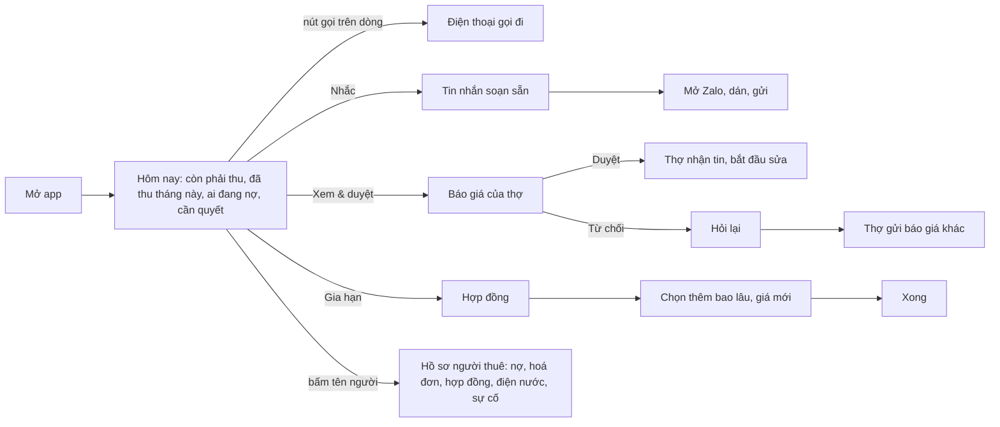
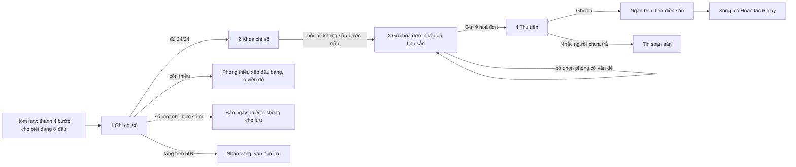
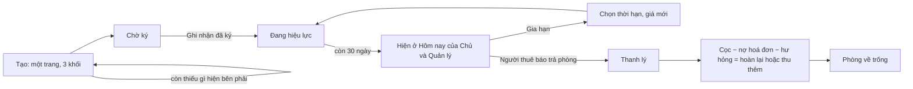
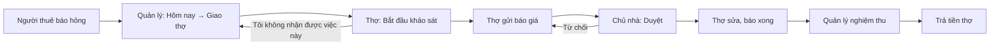
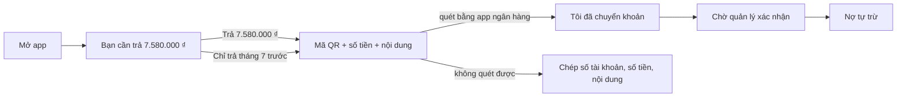

# 02 · Hành trình và workflow

Cách đếm: một **chạm** là một lần bấm hoặc nhấn; gõ chữ, gõ số ghi riêng. Cột "Hiện tại" đo trên app thật ngày 26/11/2026 bằng cách đi theo đường dẫn (chỉ GET) và đọc mã màn hình. Chỗ nào phải bấm nút ghi mới đếm tiếp được thì em ghi "chưa đo", không đoán. Cột "V3" đếm trên [prototype](prototype/index.html).

## Bảng trước / sau

| Vai trò | Việc | Hiện tại | V3 |
|---|---|---|---|
| Chủ nhà | Gọi người nợ nhiều nhất | 2 chạm (dòng → hồ sơ → Gọi) | **1 chạm** (nút gọi ngay trên dòng) |
| Chủ nhà | Nhắc nợ một người | không có | **2 chạm** (Nhắc → Mở Zalo), tin soạn sẵn |
| Chủ nhà | Duyệt một báo giá sửa chữa | ≥ 3 chạm, dòng sự cố trên Hôm nay dẫn tới danh sách chứ không tới đúng việc; nút duyệt chưa đo | **2 chạm** (Xem & duyệt → Duyệt 450.000 ₫) |
| Chủ nhà | Biết tháng này thu được bao nhiêu | không có trên trang đầu (chỉ có "thực thu 6 tháng") | 0 chạm, nhưng mới hiện được "hoá đơn tháng 11 đã thu" và "tháng 10 đã thu 68%". Số tiền thực nhận trong tháng chưa hiện, xem ghi chú dưới bảng |
| Chủ nhà | Xem nợ theo toà | 0 chạm | 0 chạm (thêm tỷ lệ thu và sơ đồ phòng) |
| Chủ nhà | Gia hạn hợp đồng sắp hết | chưa đo | 3 chạm (Gia hạn → Gia hạn hợp đồng → xác nhận) |
| Quản lý | Ghi thu cho người nợ 4 tháng | ≥ 9 chạm (mở dòng, rồi mỗi kỳ ít nhất Thu + lưu; chưa bấm lưu nên chỉ đếm tối thiểu) | **3 chạm**, một lần cho cả 4 tháng |
| Quản lý | Tới chỗ ghi công tơ còn thiếu | ≥ 2 chạm (Chu kỳ tháng → bước 1) | **1 chạm** từ Hôm nay, phòng thiếu xếp đầu |
| Quản lý | Gửi hoá đơn cả toà | chốt kỳ → tạo nháp → phát hành: 3 việc riêng | 2 việc: khoá chỉ số → gửi (nháp tự tạo) |
| Quản lý | Giao thợ một sự cố mới | tiếp nhận rồi phân công: 2 việc riêng | **2 chạm** (Giao thợ → Giao thợ), thợ gợi ý sẵn |
| Người thuê | Biết mình nợ bao nhiêu | 0 chạm | 0 chạm |
| Người thuê | Trả tiền | **không làm được** (không có số tài khoản, không có QR) | 1 chạm tới mã QR (cần backend) |
| Thợ | Biết việc làm trước | 0 chạm | 0 chạm |
| Thợ | Gọi khách | 1 chạm | 1 chạm |

Chỗ V3 không nhanh hơn em để nguyên con số, không tô vẽ.

Ghi chú về "tháng này thu được bao nhiêu": em gọi `/api/dashboard/chu` cho riêng 01–26/11/2026. API trả `thucThu = 0` nhưng `daThuHopDong = 15.367.000`, trong khi 3 hoá đơn tháng 11 đều ghi đã trả đủ 15.367.000 ₫. Hai số của cùng một API không khớp và em không biết số nào là tiền thực nhận. Vì vậy trang đầu V3 chỉ ghi đúng thứ đo được ("Hoá đơn tháng 11 đã thu"), chưa dám ghi "tháng này thu được".

## Chủ nhà

Việc theo tần suất: (1) sáng xem tiền và nợ, (2) gọi hoặc nhắc người nợ, (3) duyệt báo giá sửa chữa, (4) quyết gia hạn hay thanh lý hợp đồng, (5) xem một toà, một phòng, một người, (6) xem báo cáo cuối tháng.

Ngoại lệ:
- **Nợ nhiều tháng**: gom theo người, một số tổng. Mở dòng mới thấy từng tháng. Ghi thu trừ từ tháng cũ nhất.
- **Không ai nợ** (quy định, chưa vẽ vì dữ liệu demo luôn có nợ): khối "Ai đang nợ" còn một dòng "Không ai nợ quá hạn", không biến mất, để chủ nhà biết là đã tải xong.
- **Nợ lớn hơn cọc lúc thanh lý**: màn hợp đồng tính sẵn "Nếu thanh lý hôm nay" và báo đỏ số còn thiếu.
- **Chọn một toà**: chọn một lần ở đầu menu, mọi màn theo toà đó.
- **Mất mạng**: giữ số liệu lần cuối kèm giờ, khoá nút ghi.

## Quản lý toà

Việc theo tần suất: (1) ghi thu tiền khi khách trả, (2) nhận và giao sự cố, (3) xác nhận lịch xem phòng, (4) chu kỳ tháng, (5) tạo, gia hạn, thanh lý hợp đồng, (6) nhắc nợ.

### Vòng đời 1: chu kỳ tháng

Khác app hiện tại:
- "Chốt kỳ" đổi thành "Khoá chỉ số", "Phát hành" thành "Gửi hoá đơn". Nói đúng việc đang làm.
- Bỏ bước "tạo nháp". Khoá xong là có nháp. Frontend gọi nối hai API `chot` rồi `tao-hang-loat` sẵn có.
- Bảng ghi chỉ số là một bảng gõ liên tục: Tab sang ô kế, Enter xuống phòng dưới.
- Thanh 4 bước hiện trên cả Hôm nay, kèm số thật ("20/24 công tơ · thiếu 4").

Ngoại lệ: công tơ thiếu ở phòng trống (401, 403) vẫn phải ghi để khỏi dồn số cho người thuê sau; hợp đồng hết hạn giữa kỳ thì dòng hoá đơn nháp gắn nhãn "HĐ hết hạn 08/12"; khoá nhầm thì lập hoá đơn điều chỉnh (màn này chưa vẽ).

### Vòng đời 2: hợp đồng

Ngoại lệ: nợ lớn hơn cọc thì báo đỏ, vẫn cho thanh lý nhưng ghi khoản phải thu thêm; quá hạn báo trước thì dải vàng đầu trang nói rõ; "Thanh lý" là nút viền đỏ, không bao giờ là nút chính.

### Vòng đời 3: sự cố

Mỗi vai chỉ thấy bước của mình là việc cần làm. Danh sách sự cố chia ba nhóm: Cần quyết, Thợ đang làm, Đã xong tháng này. Tám bước hiện thành một hàng nhãn ngang, bước đang chờ tô xanh.

Ngoại lệ: việc khẩn có nhãn đỏ và đứng đầu; thợ trả việc thì quay về "Cần quyết" của quản lý; chi phí do người thuê chịu thì chọn ở ô "Ai chịu chi phí" lúc duyệt.

## Người thuê

Việc: (1) xem cần trả bao nhiêu, (2) trả tiền, (3) báo hỏng, (4) xem hợp đồng và giá, (5) xem lịch sử.

### Vòng đời 4: người thuê trả tiền

Ngoại lệ: không nợ thì màn đầu ghi "Bạn không nợ gì" và ngày có hoá đơn kế (quy định, chưa vẽ); trả một phần thì trừ tháng cũ trước; chuyển sai nội dung thì quản lý ghi thu tay.

## Thợ

Việc: (1) xem việc làm trước, (2) gọi khách hẹn giờ, (3) khảo sát và chụp ảnh, (4) gửi báo giá, (5) báo sửa xong, (6) xem tiền công.

Màn đầu là **một** việc làm trước với hai nút: Gọi khách và việc kế tiếp. Các việc khác nằm dưới, mỗi việc một dòng. Chữ thân 17 px, nút cao 52 px. Màn "báo sửa xong" chưa vẽ.

## Quản trị hệ thống

Thêm tài khoản, khoá tài khoản, xem nhật ký. Một bảng, một nút chính. Chỉ vẽ màn Tài khoản.

## Trạng thái chung

Xem màn [Rỗng, lỗi, tải, mất mạng](screens/png/36-khung-trang-thai-1440.png): đang tải giữ đúng khung; rỗng là một câu và một việc làm tiếp; lỗi báo ngay trong khối bị lỗi; ô nhập sai báo dưới ô; việc không sửa được thì hỏi lại bằng nút ghi rõ việc; xong thì báo ở đáy màn hình kèm Hoàn tác.
